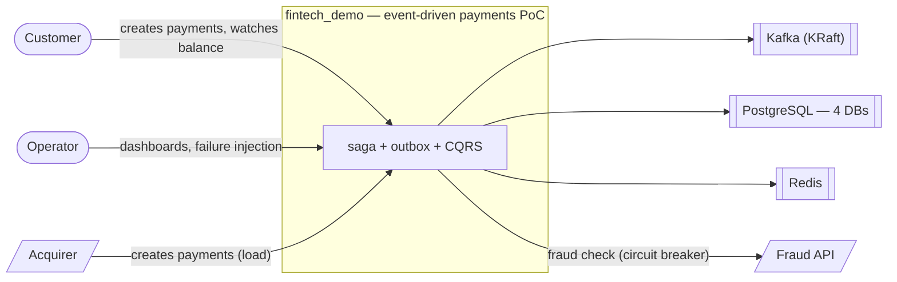
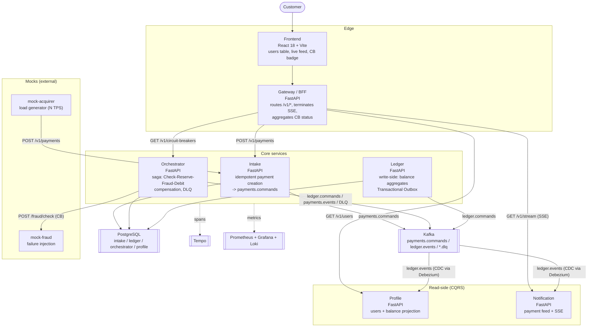

# C4 — Context & Container view

Rendered with Mermaid (renders natively on GitHub). The D2 source of the same
picture is in `doc/diagrams/c4-container.d2` (render with `d2`).

## System context

## Container view

## Boundaries that matter

| Rule | Where it is enforced |
| --- | --- |
| A service never reads another service's DB | one database per bounded context (`init/01_databases.sql`); the read-side consumes events, never a JOIN |
| The event contract lives in the domain | `shared/domain/events.py` — the canonical catalogue (tz_v2 §3.11.1) |
| Every write-side mutation + its event are one transaction | `shared/outbox.py` (ADR-008) |
| One trace per payment | `shared/tracing.py` (ADR-009) |
| A saga failure never loses the payment | compensation (`CancelReservation`) + DLQ (`ledger.commands.dlq`) |
