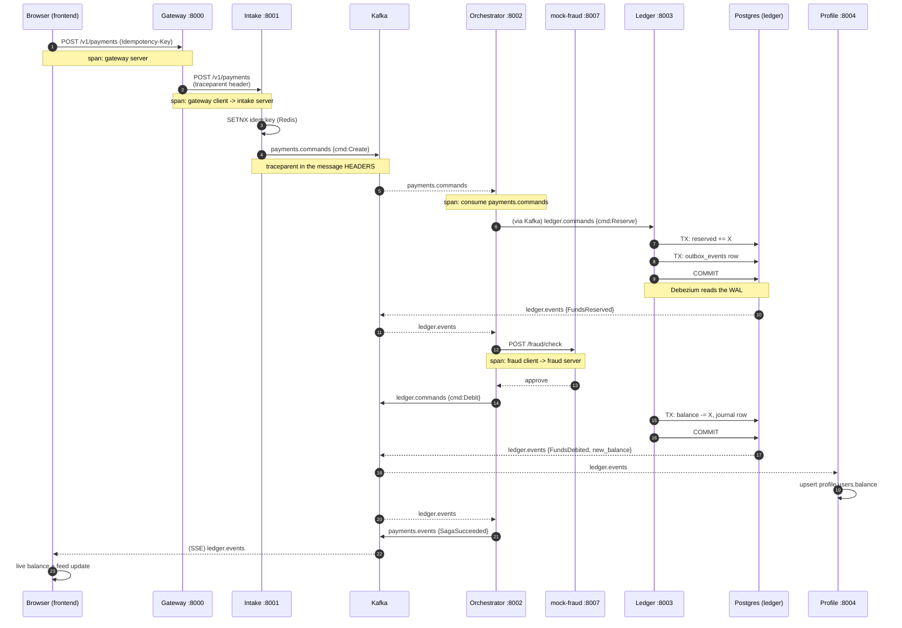
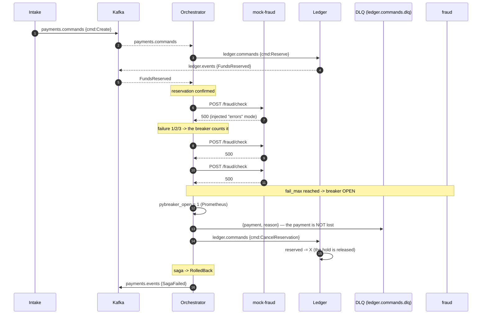
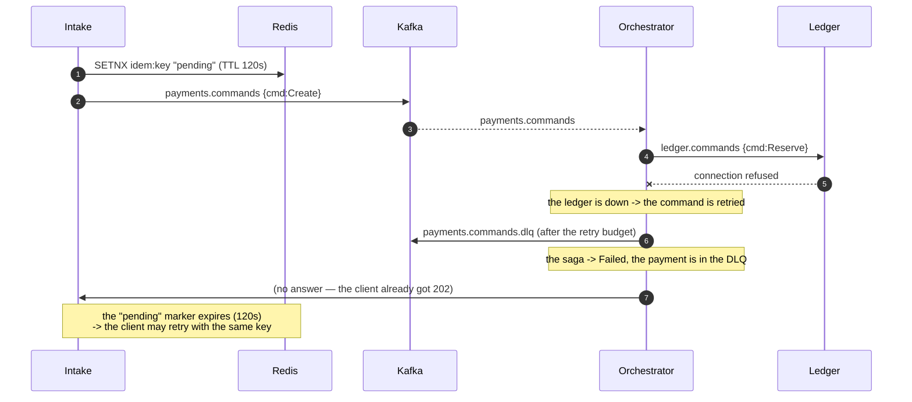

# Sequence diagrams

Rendered with Mermaid (renders natively on GitHub). The D2 source is in
`doc/diagrams/sequence.d2`.

## 1. Happy path — one payment, one trace

**Where the money is checked**

| Step | Invariant |
| --- | --- |
| Reserve | `available = balance - reserved >= amount` |
| Debit | `available >= amount`, currency must match the account (ADR-003) |
| Both | the balance change + the outbox row are ONE transaction (ADR-008) |
| Read-side | applied `event_id` is inserted once — a redelivery is a no-op (ADR-006) |

## 2. Fraud failure — the circuit breaker opens

**What the demo shows**

- The breaker opens after `fail_max` failures; the *next* call is rejected
  immediately (no call to fraud at all) — the fallback returns
  `route_to_dlq`.
- The failed payment lands in the DLQ, so nothing is lost, and the valid
  stream keeps flowing.
- `pybreaker_open` goes 0 → 1 in Prometheus; the Grafana badge turns red;
  the `CircuitBreakerOpen` alert fires (severity: critical).
- The reservation is released by the compensation — a failed payment leaves
  no hold on the account.

## 3. Ledger unavailable — the payment is not lost

**Why the pending marker is short-lived**

`Idempotency-Key` uses two TTLs: the `pending` marker is **120 s** (so a
worker that dies mid-flight does not wedge the key forever) and the final
answer is **24 h** (the contract). A 5xx never stores an answer.
